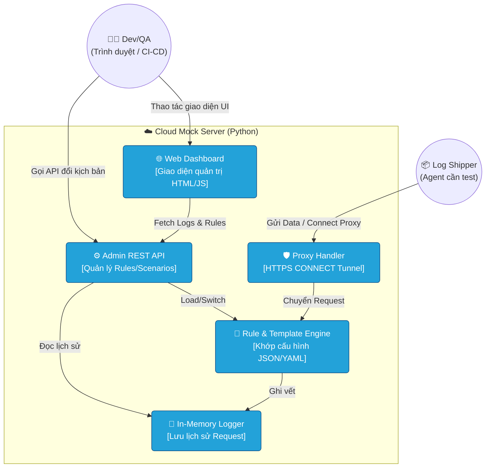
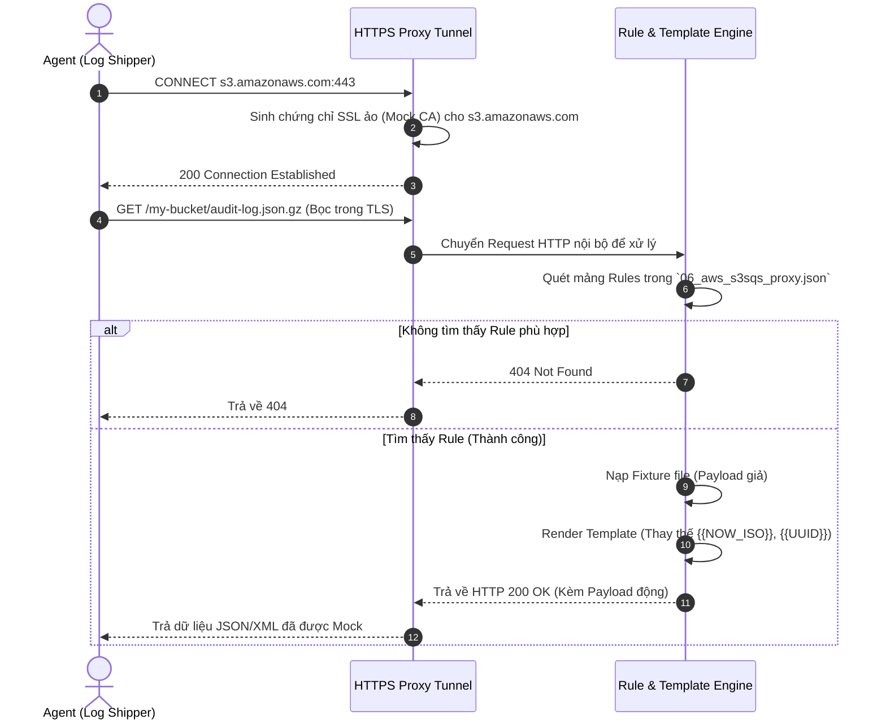
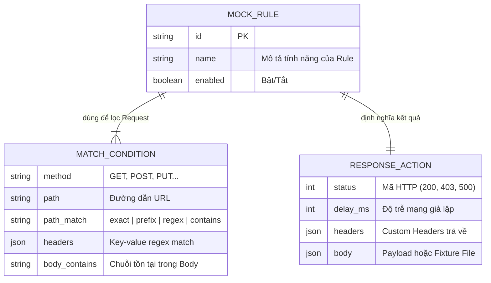

# Tài liệu Thiết Kế Kỹ Thuật (Architecture Overview) - Cloud Mock Server

**Tác giả:** Antigravity AI  
**Trạng thái:** Active  
**Ngày phân tích:** 06/10/2026  

---

## 1. Bối cảnh & Vấn đề (Context & Problem Statement)
Trong quá trình phát triển các hệ thống tích hợp (Integration) và thu thập log (Log Shipper) từ các nền tảng Cloud lớn (AWS, Azure, Microsoft 365, v.v.), đội ngũ QA/Dev gặp khó khăn vì:
- API Cloud thực tế thường có chi phí gọi cao, bị giới hạn tốc độ (Rate Limit), hoặc khó tái hiện các kịch bản lỗi mạng, lỗi hết hạn Token.
- Không thể tạo ra hàng nghìn log giả lập trên môi trường thật để làm bài test chịu tải (Stress Test).

Vì vậy, dự án **Cloud Mock Server** ra đời như một máy chủ độc lập chuyên dụng, giả lập 100% các hành vi của 6 nguồn Cloud Log phổ biến.

## 2. Mục tiêu & Tính năng lõi (Goals)
- **Giả lập Đa Nguồn (6 Sources):** Hỗ trợ REST API truyền thống, Azure, MS Defender, MS 365, AWS CloudWatch, AWS S3-SQS.
- **HTTPS Proxy Tunneling:** Có khả năng đứng chặn giữa (Man-in-the-Middle) và tự sinh chứng chỉ SSL giả (Mock Root CA, SAN) cho các domain thật như `*.microsoftonline.com` hay `*.amazonaws.com`.
- **Luật động & Kịch bản (Rule & Scenario Engine):** Khai báo Input/Output hoàn toàn qua file JSON/YAML mà không cần sửa code Python. Có thể đổi qua lại giữa các tình huống như `rate_limit_429`, `auth_fail_401`, `server_error_500` chỉ bằng 1 click.
- **Template Engine:** Tự động sinh dữ liệu thực tế (Real-time placeholders) như `{{NOW_ISO}}`, `{{UUID}}`, `{{MD5:...}}` vào trong Response Body.
- **Web Dashboard & Admin API:** Cung cấp giao diện trực quan tại `http://localhost:8081/mock/admin/` để theo dõi request real-time và API để tích hợp CI/CD.

---

## 3. Kiến trúc Tổng thể (C4 Model)

### C4 Level 2: Container Diagram

---

## 4. Luồng Tương tác Nghiệp vụ (Sequence Diagrams)

### Luồng 1: Xử lý Request thông qua HTTPS Proxy Tunnel (Ví dụ gọi AWS S3)
Luồng này thể hiện cơ chế mà Mock Server làm giả một domain thật (Ví dụ `s3.amazonaws.com`) và dùng Rule Engine để trả về Payload giả. Yêu cầu bắt buộc: **User -> Proxy -> API**.

**Mô tả các bước thực hiện:**
1. **Bước 1:** Ký giả (`Agent / Shipper`) gửi lệnh `CONNECT` qua TCP tới cổng Proxy của máy chủ Mock để đòi nói chuyện với domain thật (AWS).
2. **Bước 2:** `Proxy` sinh chứng chỉ giả mạo (Fake SSL Cert) và trả về `200 Connection Established`. Kể từ đây, kết nối TLS giữa Agent và Mock Server chính thức thành lập.
3. **Bước 3:** `Agent` gửi request lấy file thực sự (đã được mã hóa). `Proxy` giải mã và chuyển cho `Rule Engine`.
4. **Trường hợp Lỗi:** Nếu không có Rule JSON nào khai báo khớp với URL/Header/Body này, hệ thống ngắt luồng và trả về `404 Not Found` (Agent sẽ nhận cảnh báo).
5. **Trường hợp Thành công:** Engine nạp file mẫu từ thư mục `fixtures/`, biến đổi các biến động (ngày giờ hiện tại), và phản hồi `200 OK` ra ngoài cho Agent hoàn tất quy trình lấy log giả lập.

---

## 5. Mô hình Dữ liệu (Mock Rule Schema)

Vì dự án thuần túy dựa trên các cấu hình JSON (Data-driven), dưới đây là cấu trúc lõi của một Rule Object được dùng trong Engine:

---

## 6. Tổng kết Vận hành & Bảo mật
Dự án được thiết kế 100% bằng **Python thuần** (`server.py`) không sử dụng các dependencies nặng nhằm tối ưu tốc độ và đơn giản hóa khâu cài đặt.
- **Start Daemon:** `./run.sh start -d`
- **Dashboard:** Truy cập cổng mặc định `8081` để theo dõi log.

Tài liệu này được biên soạn dựa trên cấu trúc cây thư mục, `README.md` và tuân thủ các quy tắc TDD/C4 của hệ thống Antigravity Loogix.
